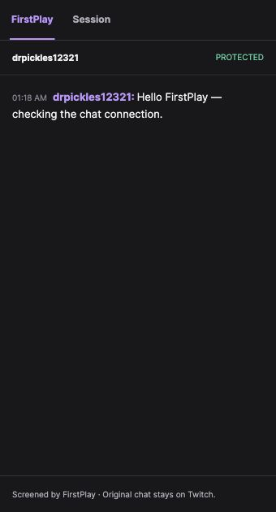

# FirstPlay

[](https://github.com/DrPickles12321/firstplay/actions/workflows/check.yml)

**Keep the surprise. Keep the conversation.**

FirstPlay screens Twitch chat before it reaches a streamer playing a discovery game or a no-hints challenge. Viewers keep ordinary Twitch chat. The streamer reads approved original messages inside Twitch, in a private OBS dock, or in FirstPlay's standalone reader.

Its useful distinction is **what the player has discovered**. A reaction mentioning an unseen creature can stay hidden, then become eligible after the name appears on screen. Knowing the name still does not permit an instruction about what to do with it.



## Try it

The verified environment is **macOS, Chrome, Node 22.22.3 and Codex CLI 0.164.0-alpha.11.1**. Node 22.13+ is required. There are no npm dependencies. Text screening uses your signed-in Codex account and its normal usage; no OpenAI API key is needed. Inference is a service call, not an offline model.

```sh
nvm use
npm install -g @openai/codex@0.164.0-alpha.11.1
codex login
npm run doctor
npm run demo
```

Open **http://localhost:3213** for the isolated real-model demo. It has separate storage/cookies and cannot connect to Twitch or a public gateway. **Settings → Check model connection** verifies actual inference without sending chat. The [judge quickstart](docs/firstplay-judge-quickstart.md) gives a short before/after walkthrough and troubleshooting.

For credential-free verification:

```sh
npm run check
npm run recognition:check    # macOS + Apple Command Line Tools
```

`npm run release:check -- --with-model` also runs real-model before/after/undo checks and packages source. It never posts to Twitch unless `--with-twitch` is explicitly added.

## Connect your channel

1. Copy `.env.example` to `.env`; enter your own Twitch developer application's client ID/secret. Register **http://localhost:3211/auth/callback** as its OAuth redirect URI.
2. Run `npm start`, open **http://localhost:3211**, then **Settings → Connect Twitch** as the channel owner. Normal use requests only `user:read:chat`.
3. Install and pair the [Chrome extension](firstplay/extension/README.md) for the protected reader on Twitch, or use FirstPlay directly. Viewers install nothing.
4. Open **Gameplay**, share only the game/video source, and keep that capture page open. Subnautica recognition starts automatically. Browser source selection is a required one-time user action; a backend restart can reuse an active source.

Optional **Enable test messages** adds `user:write:chat`. Then `npm run live-check` posts two fixed integration messages to the connected owner's channel. It has a cooldown and refuses Shared Chat. Normal operation has no chat-send, delete or ban permission.

## What is included

| Surface | Purpose |
|---|---|
| Stream | Video on the left, protected reader on the right, current connection/readiness below the player |
| Settings | Game/run, filtering, model check, Twitch, extension pairing and distinct OBS links |
| Gameplay | Automatic discovery recognition, private evidence, history and Undo |
| Moderation | Expiring raw review queue, private decisions/reasons and manual discovery corrections |
| Lab | Optional case review and four-scene video/chat rehearsal; not needed during a stream |
| Viewer status | A signed-in chatter's own delivered/pending/not-delivered markers |

The optional extension adds **FirstPlay / Session** tabs to desktop Twitch channel pages. It covers native chat while enabled, including other channels; an unavailable service or unsupported layout keeps chat covered. Pairing grants only channel-bound reader access. This is a local unpacked prototype, not a Web Store release. See its [permissions and limits](firstplay/extension/README.md).

Use **Private OBS dock** in OBS's Custom Browser Docks for the streamer. Use the separate **Broadcast overlay** URL only when approved chat should appear in the outgoing video. Keep capability URLs private. FirstPlay does not delete or alter viewers' original Twitch messages.

## Automatic Subnautica progress

The opening pilot uses **Apple Vision on this Mac**, with no gameplay-image calls to the text model. Eight supported single facts can be recognized: the PDA inventory screen and the names Boomerang, Scanner, Repair Tool, Seaglide, Cave Sulfur, Writhing Weed and Creepvine. Recognition checks exact labels plus their expected UI context.

A knowledge update requires **four matching frames across two consecutive checks**. Weak evidence stays hidden or becomes optional moderator review. No detector infers possession, crafting, recipe relationships or unseen secrets. Every update has provenance, private evidence and Undo; undo blocks immediate relearning. New chat uses the new knowledge, while old hidden messages stay hidden.

Native fixture checks exercise all eight mappings and negative contexts. A user-selected real recording also established the PDA screen automatically. These are bounded examples, not measured gameplay precision/recall. English/macOS only; the first build needs Apple's Command Line Tools. Full details: [recognition and corrections](docs/firstplay-subnautica-recognition.md).

## How screening works

```text
Twitch EventSub → small batches → structured text interpretation
                                     ↓
                       validated references + policy gate
                         ↙              ↓             ↘
                      reject       short review       approve
                                                       ↓
                                          private original-message reader
```

The text model receives authored game context and explicit known facts/relationships. It interprets meaning; keyword retrieval only supplies candidate references. A separate policy gate enforces Discovery or Strict social rules, optional gentle guidance and scoped one-hint requests. Chat claims never add discoveries. There is no model training or fine-tuning.

Malformed output, provider failure, expiry, overload or stale knowledge **never release unchecked text**. Replies depend on their visible parent. Rule/discovery changes invalidate in-flight approvals. Exact repetitions may reuse a successful interpretation for thirty seconds under identical context; different wording always needs new interpretation.

The reader receives approved text only. It cannot fetch hidden messages, future packs, private reasons or evidence. A delivery receipt means a reader rendered the message, not that a human read it. Broadcast overlays cannot generate private-reader receipts.

## Scope and evidence

- **Subnautica opening:** 40 authored facts, nine relationships, 14 manual events and eight bounded automatic text mappings.
- **Mario Cap → Cascade:** preserved separate run, 47 opening facts, nine relationships and curated events. The 836-objective Moon reference index represents 880 Moons; it is not a whole-game reveal graph. Mario image suggestions remain manual and their positive gameplay accuracy is unvalidated.
- Latest release verification: **131 controlled tests, 61 JavaScript syntax checks**, nine native OCR fixture pairs, real-model before/after/undo and a fresh two-message Twitch → EventSub → model → installed-reader check.
- Four saved assisted human scene judgments remain intact. The 79-case Subnautica benchmark has **no completed independent human review**; synthetic draft-label scores are development diagnostics, not an accuracy claim.
- Text screening usually takes several seconds on the tested Codex route. Representative high-volume chat, multilingual play and broad game coverage remain unvalidated. Display names, TTS, alerts and other chat clients remain exposure paths.

See [current implementation evidence](firstplay/IMPLEMENTATION.md), [privacy and supported scope](docs/firstplay-privacy-and-scope.md), and the [submission draft](docs/firstplay-submission-draft.md). No zero-spoiler guarantee is claimed.

## Configuration and source

`.env` holds local configuration; `.data` holds encrypted runtime state. Neither belongs in source control. The default app binds to loopback. A [viewer-only gateway](docs/firstplay-privacy-and-scope.md#remote-viewer-status) is implemented but not publicly deployed. A remote chatter cannot use a localhost status link; the main operator port must stay private.

The optional API route uses `FIRSTPLAY_PROVIDER=openai`, `OPENAI_API_KEY` and `OPENAI_MODEL`; it has no real-account verification in this release. The tested default is the isolated Codex CLI route. `CODEX_BIN` can point to the CLI when it is absent from PATH. Do not remove isolation flags to work around incompatible CLI versions.

`npm run package:source` creates an allowlisted ZIP and SHA-256 manifest, excluding credentials, saved chat/state, artifacts, gameplay recordings and the unrelated legacy prototype. Research links are provenance, not media licenses. No third-party gameplay media or music is bundled.

This source archive excludes the unrelated legacy prototype, runtime data and third-party gameplay media.
