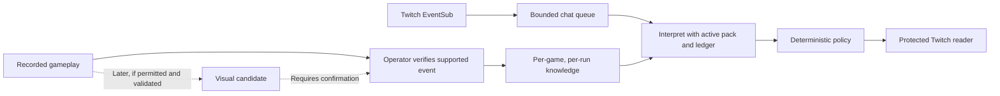

# FirstPlay: Subnautica Part 1, alongside Mario

Research date: October 30, 2026, America/New_York. Updated implementation status: the manual-progress second-game slice is now implemented and connected to real Twitch chat. Mario remains available with its migrated saved progress. The original audit and later vision architecture below are planning history, not claims that all proposed detectors are complete. See [the implementation checkpoint](../firstplay/IMPLEMENTATION.md) and [current demo instructions](firstplay-subnautica-demo.md).

## Decision

Add **original Subnautica, English PC opening** as a second selectable game pack. Use [Royalty Free Game Clips' Part 1](https://www.youtube.com/watch?v=hh5dckAV5Pg) as a small development fixture. Keep Super Mario Odyssey's Cap → Cascade pack, collectible references and tests intact.

The promise remains: viewers use normal Twitch chat; the creator reads screened original messages inside Twitch through FirstPlay. Normal conversation and harmless reactions to confirmed discoveries can pass. Unrequested instructions, new mechanics, hidden encounters and future information stay hidden. Chat never establishes player knowledge.

The differentiating demonstration is **the same harmless named-item reaction becoming eligible after on-screen confirmation**, while an instruction involving that item remains prohibited. This is stronger than a fixed forbidden-word list. It does not require the observer to understand the entire game.

Recommended initial confirmation events: a named inventory item, a named target in the world, and optional extinguisher use. Start with manual confirmation and text filtering; the pixel-to-model path remains conditional on the publisher-policy question below. Scanner completion, water fabrication, radio repair and Seaglide progression are later work unless suitable evidence is actually found. No automatic knowledge updates ship with this first Subnautica build.

## What the research establishes

- Original Subnautica is a single-player underwater survival/exploration game. Its [publisher's Steam listing](https://store.steampowered.com/app/264710/Subnautica/) establishes the game identity; Below Zero and Subnautica 2 are separate scopes.
- A [Subnautica streamer described the exact problem](https://www.reddit.com/r/Twitch/comments/ldkusy/): chat revealed unseen names and how ingredients/tools connect before moderation could prevent exposure. This is direct anecdotal evidence, not a measurement of how common the problem is.
- [AutoMod](https://help.twitch.tv/s/article/how-to-use-automod?language=en_US) documents category moderation and blocked terms. This research did not establish a player-discovery ledger in that product. FirstPlay's proposed advantage here is contextual eligibility, not a claim that nobody has ever built an AI spoiler filter.
- FirstPlay now supplies an isolated Subnautica run, authored domain data, manual evidence controls, text filtering and its existing Twitch/Chrome reader. Validated automatic visual recognition remains future work.

All source URLs and verification limitations are recorded in [sources.json](../research/firstplay/subnautica/sources.json). Some community guides contain old or conflicting quantities. This scope avoids adopting numeric nutrition, exact routes or outdated starting inventories from those guides.

## The actual recording, rather than the title

The browser player reports **632.641 seconds**, displayed as **10:32**. The uploader description identifies PC footage and publishes reuse terms. The recording begins with the lifepod launch introduction. Its exact game build and Survival-versus-Hardcore mode are not established.

Sixteen decoded point samples were inspected. These are research observations, not continuous review, event-onset labels or exhaustive negative windows. Transient black frames while seeking were excluded. The structured notes are in [part1-recording.json](../research/firstplay/subnautica/part1-recording.json).

| Sample | Useful evidence | Interpretation limit |
|---|---|---|
| 00:45–00:55 | Fire, extinguisher and active spray | Do not infer a completed repair or permanent fire-out state |
| 02:00 | Ocean and damaged ship | Seeing a ship does not establish its name, entry route or future |
| 03:00 | Writhing Weed target label | Name only; no botanical properties |
| 04:30 | Boomerang inventory tooltip | Separate player inventory from the storage pane |
| 05:00 | Flare tooltip and Seaglide 0/2 list entry | A recipe/list is not crafting; 0/2 is not blueprint completion |
| 08:00 | Creepvine target label, held fish | Do not identify an ambiguous fish or infer seed collection |
| 10:25 | Held fish inside the pod | No completed tool fabrication established |

The inspected samples do **not** confirm a crafted Scanner, completed scan, crafted Filtered Water, crafted Repair Tool, repaired Radio or completed Seaglide. This is not proof those actions never occur between samples. A complete interval review is a prerequisite for using the recording as a detector benchmark.

This makes Part 1 useful for early identity recognition and hard negatives. It is a weak sole fixture for a scanner-to-blueprint demonstration. Do not script a later discovery into the demo merely because it would be convenient.

## Reuse and the no-email path

The creator's published description permits commercial and noncommercial use of their recording and says attribution is optional. That is existing creator permission; the plan does not depend on emailing them. Record the source and credit them anyway.

The [Unknown Worlds video policy](https://unknownworlds.com/en/pages/video-policy) permits gameplay videos under conditions, including free viewing, attribution of the game's work to its developer, logo restrictions and a restriction on licensing recordings. It is not an unrestricted asset license.

The [newer guideline](https://subnautica.com/en/policy/content-guidelines) eventually loaded in Chrome. Titled **Subnautica 2 Fan Content Creation Guidelines**, it restricts sequel assets as AI training, fine-tuning or reference inputs without written permission. Its broad franchise-IP wording leaves original-game applicability unclear. This research does not establish that original-game vision inference is cleared. The immediate fallback is manual progress confirmation with text filtering; do not send Subnautica frames to a model until the applicable permission basis is established. This corrects the earlier overly broad implication that an uploader's video-reuse statement settles AI-input rights.

Consequently, the uploader's statement establishes their offered permission, **not blanket clearance for every underlying right, model use, redistribution or the organizer's promotional use**. Do not call the material public domain or promise no possible claims. The [hackathon rules](https://twitchcon-codex.devpost.com/rules) require authorization for third-party integrations/material and rights to the submission. Keep these questions visible before public distribution; they do not prevent completing this research or building the game registry and manual controls.

Initial packaging contains source references, original code and authored synthetic chat examples, not downloaded gameplay, soundtrack, thumbnails, guide images or full PDA text. No training dataset or fine-tuning job is proposed. Published video reuse terms must not silently be relabeled as training permission.

## Exact support boundary

| Tier | Include | Exclude |
|---|---|---|
| Part 1 v0 | Lifepod/fire context, generic ocean/fish reactions, specifically verified names, inventory tooltip evidence, conservative no-hints filtering | Whole-game recognition, automatic plot progression, arbitrary species identification |
| First visual candidates | Boomerang inventory tooltip; Writhing Weed/Creepvine labels; possibly extinguisher use | Crafting inferred from a menu or from owning ingredients |
| Reference-only negative context | Scanner, water, Repair Tool, Radio and Seaglide relationships | Treating these as discoveries just because they are in the reference pack |
| Later expansion | Specific crafting transitions, completed target scans, blueprint unlocks, independently verified radio messages | Automatic activation based on an optimistic game-time estimate |

No forced route, biome boundary or elapsed-time progression. The starting location can vary, and play order is flexible. English HUD evidence is the initial visual target; multilingual message interpretation remains required. An unsupported visual language produces uncertainty rather than guessed updates.

## Knowledge model

The [draft pack](../research/firstplay/subnautica/part1-pack.draft.json) contains **40 facts, nine relationships and 14 possible confirmation events**. All facts start unknown. Every automatic confirmation flag is false. Facts include a source, support tier and draft-review status. Reference-only material helps identify disclosures; it does not enlarge the positive detector scope.

| Distinction | Example | Evidence needed |
|---|---|---|
| Visible entity | There is a fish on screen | Clear gameplay appearance; generic identity only |
| Named entity | This is a Boomerang | Readable exact label tied to the correct object |
| Possession | The player has that fish | Named player-inventory entry or verified equipped item; storage is separate |
| Property | This fish is edible | The specific tooltip/property was visible and confirmed |
| Recipe relationship | Bladderfish can become Filtered Water | The specific recipe/use was shown or independently verified |
| Completed action | Water was fabricated | Identified output plus a witnessed fabrication transition |
| Blueprint progress | A fragment was scanned | Target-specific completion/counter change; not a targeting reticle |
| Blueprint unlocked | Research is complete | Exact completed blueprint evidence, not a partial fraction |
| Story knowledge | A particular message was heard | Specific playback/log evidence; a repaired Radio is insufficient |

Known components never imply the connecting recipe. Known fish and known water do not establish fish → water. Knowing a Scanner name does not establish possession, use, every target's scan or every future technology. A default blueprint existing in the game is not proof the creator inspected it.

Use IDs prefixed `sn1.`. Preserve all existing Mario IDs. Game identity, pack revision and run identity must be present in state, inference context, caches, observation records and replay reports. No cross-game identity aliases.

Reference-only facts are not routine Part 1 confirmation controls. They are negative-context definitions and counterfactual classification fixtures. Expose only the reviewed event grants for this segment; expanding positive support requires a new reviewed pack revision. A later scan implementation needs a separate target-specific fact for each relevant scan, not one global “scan completed” flag that could authorize all technology.

All facts are definitions of confirmable knowledge, not claims that the current player has learned them. The authoritative ledger is the only source of confirmed IDs. Before activation, review wording to ensure the reference statements cannot be mistaken for current player state.

The proposed flow keeps evidence and chat separate:

## Message policy

Reuse current policy semantics. Do not introduce a silent “survival emergency” exception or treat streamer questions as permission to provide a solution.

| Message/state | Discovery, hints off | Why |
|---|---|---|
| “I had pasta for dinner.” | Allow | Unrelated conversation |
| “My scanner at work is broken.” | Allow | An item word alone does not establish game relevance |
| “That boomerang fish is adorable,” before identity confirmation | Hide/review | Unconfirmed name; no automatic knowledge claim |
| Same reaction, after identity confirmation | Allow | Benign known-event discussion |
| “Catch a bladderfish to make water.” | Reject | Exact instruction, regardless of whether the recipe is known |
| “Those fish might solve your thirst problem.” | Reject | Indirect hint about a relationship |
| “Bladderfish turning into water is weird,” after both entities but no relation | Reject | Components do not establish the connection |
| Same recap after the exact relationship is confirmed | Allow | Retrospective discussion with no action guidance |
| “Nice Scanner craft,” when only the recipe name was visible | Hide/review | An unsupported achievement claim needs evidence |
| “Wait until you see what is behind that ship.” | Reject | Foreshadowing/attention guidance |
| “Oxygen!” in gameplay context | Reject as strategic warning, or review if meaning is unresolved | No unsolicited hints preset includes reminders |
| Safe text plus one prohibited hint | Reject entire message | No partial rewriting |
| Reply to rejected parent | Reject | Original context is unavailable to the creator |

`Strict social` rejects game discussion, even confirmed reactions. `Discovery` permits benign confirmed discussion. Gentle hints are optional and limited to broad exploration; direct moves, exact recipes and future encounters remain prohibited. The existing named-topic, moderator-selected one-hint permission remains explicit and temporary.

False or invented spoilers can still spoil expectations. A clear future claim/directive can be rejected without proving its truth or maintaining the entire game's story graph. An unfamiliar neutral reference is hidden for bounded review. Unrelated conversation is not uncertain simply because it is missing from the game pack.

Retain independent message classification, whole-message rejection, hidden-parent rules, review TTL, conservative failures, private short reasons and unfiltered display names as previously selected. Coordinated clues split across messages remain a documented limitation; there is no cumulative solver in this scope.

## Pre-implementation audit and proposed changes

The existing abstractions are useful, but the running application is **not already a multi-game product**.

| Current file | Finding | Required change |
|---|---|---|
| `firstplay/ml/catalog.mjs` | `load()` always loads Mario; context/version include Moon-specific assumptions | Allowlisted game registry and game-neutral context warnings; preserve Mario supplemental catalogs |
| `firstplay/server.mjs` | One catalog/engine/observer created at boot; catalog endpoint has Cascade filtering | Explicit owner-controlled pack/run lifecycle and generic catalog groups |
| `firstplay/runtime/knowledge.mjs` | One persisted `state/knowledge` key | Namespace by game, pack and run; do not restore another game's discoveries |
| `firstplay/runtime/engine.mjs` | Epoch protects policy/discovery races, but is not a full playback/run identity | Add stable run identity and source generation; make switches cancel old work and clear feeds atomically |
| `firstplay/ml/reuse.mjs` | Context/pack/revisions already contribute to exact-interpretation reuse | Preserve these checks; add explicit game/run/source identity and clear on switch/seek |
| `firstplay/ml/observer.mjs` | Two images, event allowlist, candidates and manual confirmation already exist | Per-pack detector guidance; source timestamps/generation; corroboration; no automatic confirmation |
| `firstplay/public/app.js` | Stream title hardcodes Mario; catalog/evaluation controls assume current pack | Safe game/segment labels and one selector within Settings; dynamic moderator controls |
| `firstplay/cli/classify.mjs`, `evaluate.mjs` | Catalog loading and default dataset are Mario-specific | Explicit allowlisted game option; pack-bound datasets and reports |
| `firstplay/runtime/extension-access.mjs` | Read-only channel-bound feed; safe session metadata | Include safe selected-game/run metadata; keep the same Twitch pairing and permissions |
| `firstplay/cli/live-check.mjs` | Two fixed Mario-oriented posts | Separate fixed Subnautica fixture selected only for the active game; keep recipient restriction and cooldown |

This table records the original audit. Game/run isolation, atomic discovery updates, game-specific UI/CLI/evaluation, safe feed metadata and the fixed Subnautica live-check fixture have since been implemented. Source-timeline identity, seek/replay tracking and automatic visual recognition are deferred because the Subnautica image path remains disabled. Existing Twitch credentials, extension permissions and pairing grants remain usable.

### Safe game switching

1. The owner selects **Settings → Game → Subnautica → Opening**. A Twitch category change may suggest a pack, never silently load it.
2. Pause delivery, cancel in-flight classification/observations, invalidate the previous epoch/source generation and clear old rendered messages.
3. Commit the selected pack, a new run and its empty ledger transactionally. Loading a prior run is an explicit separate choice; never merge histories.
4. Replace references, observer guidance and evaluation dataset. Clear interpretation reuse and pending review/hint requests from the old run.
5. Return only safe game/segment/run labels to readers, then resume delivery. The extension's existing epoch change clears its old DOM.
6. Late callbacks from Mario, another video, another run or an earlier seek cannot confirm facts, release text or acknowledge new messages.

Give persistence a deliberate schema migration. Preserve the current Mario record under its own original-game run; do not reset it as a shortcut. Multi-fact event confirmation should be a single transaction so a storage failure cannot leave a half-confirmed event.

### Proposed implementation contracts

These endpoints and fields are a design, not available commands:

| Contract | Authority and input | Result/invariant |
|---|---|---|
| `GET /api/games` | Owner; registry metadata only | Allowlisted IDs, names, segment and support level; no filesystem paths or future fact text |
| `POST /api/session/start` | Owner; `gameId`, `packId`, `expectedRunId` | New `runId`/epoch, empty ledger, source generation and safe summary; optimistic concurrency prevents accidental double switch |
| `POST /api/session/restore` | Owner; exact saved run and expected current run | Explicit restore, new epoch/source generation; never merge ledgers |
| `POST /api/source/bind` | Owner; current run and chosen source type | New capture-session/source-generation identity; invalidate old frames and candidates |
| `POST /api/observe` | Authorized operator; two frames plus game/pack/run/capture identities and timestamps | Supported candidates only; reject stale identity, oversized frames and disallowed vision execution |
| `POST /api/observations/confirm` | Operator; candidate ID, expected run/revision and verified evidence | Atomic, allowlisted fact/relation grants; audit actor and evidence |
| Reader/extension feed | Existing scoped reader role | Approved messages plus safe game/run metadata; no game reference library or raw review |

Use the existing origin/host/access checks. Do not accept a pack path, arbitrary URL, model-produced state patch or client-supplied list of facts to mark known. Unauthorized operations return an access error; stale run/source/revision operations return a conflict; disabled vision returns a clear unsupported-state error without processing images. Requests need idempotency where retrying could otherwise duplicate a run or event.

Persistence groups should distinguish a run header, its ledger, its evidence/audit events and its temporary messages. Pack version changes require explicit migration/review rather than silently interpreting old IDs against new facts. Keep Twitch credentials and channel pairing separate from game saves. The same channel pairing can keep reading the currently selected run.

## Video input without a Switch or downloaded file

The immediate path is **normal public video playback with manual operator confirmation and text-only chat filtering**. It requires no Switch and submits no gameplay frames to a model. The following capture architecture is scoped for later activation once its permission basis is established.

For that later path, use normal playback in a separate browser tab plus an explicitly selected capture surface. The creator opens the clip and uses FirstPlay Gameplay capture. Frame sampling comes from the chosen surface, not from Twitch chat or a presumed Twitch game-state API. Start with the existing two-frame/manual-candidate mechanism before adding continuous observation.

[MDN documents](https://developer.mozilla.org/en-US/docs/Web/API/MediaDevices/getDisplayMedia) that display capture requires a user gesture and fresh permission. A website cannot silently acquire the creator's screen. Setup is a one-time action per capture session, not extra work for every chatter/message. Preview and crop locally to the game rectangle so browser recommendations, account details and unrelated chat do not go to the model. Capture no audio in v0.

A [YouTube iframe](https://developers.google.com/youtube/iframe_api_reference) can supply playback controls and a clock, but it does not provide an arbitrary frame-reading API. [Cross-origin canvas restrictions](https://developer.mozilla.org/en-US/docs/Web/HTML/How_to/CORS_enabled_image) prevent treating an ordinary embed as a readable local video. Do not add a YouTube download extractor or bypass those restrictions.

For v0, leave playback outside FirstPlay; no new YouTube extension host access or remote script/CSP expansion is needed. A later optional official player integration can synchronize time, but capture is still separate. Locally supplied, appropriately licensed video remains the preferred deterministic replay input if one becomes available.

Two clocks are necessary: capture's monotonic time and source media time when known. Wall-clock elapsed time is not reliable source position because video can pause, buffer, change rate or seek. If only screen capture is available, record source time as unknown unless it is deliberately synchronized. Do not present that as a frame-exact replay benchmark.

Every frame pair carries `gameId`, `packVersion`, `runId`, `captureSessionId`, `sourceGeneration`, capture times, optional media times and frame hashes. Source changes and seeks invalidate pending candidates. Seeking backward requires a new run or an explicit restore/rebuild from earlier verified evidence; it must not retain future knowledge. Evaluator annotations never advance the production ledger.

## Observation design and hard negatives

Begin with two distinct frames roughly one second apart. This is an experiment setting, not a validated threshold. Exact hash difference alone does not establish independent useful evidence. Crop and reduce frames locally; retain the existing input-size limits and temporary/private evidence retention.

| Detector | Positive candidate | Hard negatives | First-release behavior |
|---|---|---|---|
| Named inventory | Exact Boomerang tooltip, matching icon, correct player pane | Storage item, recipe icon, cursor on adjacent fish, alias guessing | Moderator confirms identity/possession/property separately as supported |
| Named target | Exact Writhing Weed or Creepvine label plus matching target | Label from PDA list, background plant, tiny unreadable text | Confirm the name only |
| Extinguisher use | Held matching tool with active spray and matching scene | Tool merely held, bubbles, smoke, fire only | Optional candidate; no “fire solved” inference |
| Recipe visibility | Specific readable selected tooltip | Default list, brief hover, missing ingredient, unavailable recipe | Manual verification only |
| Crafting | Named output plus witnessed completion/possession transition | Recipe hover, enough ingredients, pre-existing inventory | Deferred until a positive clip and negatives are available |
| Completed scan | Exact target plus completion and persistent outcome | Reticle, partial progress, scan interrupted | Deferred |

Model outputs stay inside the supplied event-ID allowlist. A candidate is not a fact. Display evidence to an authorized moderator, then confirm/reject. Unknown or conflicting evidence creates no positive update. Revocation invalidates in-flight interpretation and removes eligibility immediately.

Do not call vision for every message. A bounded observer loop updates the compact ledger; chat interpretation uses that ledger. Deduplicate stable frames, avoid observing menus repeatedly, allow one observer request at a time and bound the candidate queue. Add a vision request budget, since the existing chat batch budget does not currently govern vision calls. Chat receives scheduling priority. Measure real vision latency before deciding any production sampling cadence.

Automatic promotion is an event-specific later gate: independently reviewed positives, hard negatives from different sessions/builds, full temporal evaluation and no false positive knowledge grants in the acceptance corpus. A single clip or a model's confidence number is insufficient. With this available footage, automatic promotion remains off.

## UI and community workflow

- Keep the existing single top-bar navigation. Put the one game selector in Settings, not a second rail or multiple shortcuts.
- The Twitch reader remains familiar: FirstPlay and Session tabs; safe game name, support level, connection and confirmed count. No future fact list, held message, reason or observer evidence appears in the creator reader.
- The moderator sees candidates, source age and exact proposed knowledge grants. Confirming Creepvine must not quietly check rubber, seeds, a biome or every related recipe.
- Chatters continue in native Twitch chat. The separate status panel can show whether their own message was delivered. Remote viewer hosting/sign-in remains the existing unfinished task; this second pack does not solve it.
- A renderer acknowledgement still means rendered in a protected reader, not that the creator read or understood it.
- During capture loss, filtering continues against the last confirmed ledger. Show safe “progress tracking disconnected” status. Do not uncover native chat or guess missing progress.

## Evaluation and acceptance

[draft-cases.jsonl](../research/firstplay/subnautica/draft-cases.jsonl) contains **79 authored, unreviewed examples**: social homonyms, known/unknown reactions, state pairs, recipes, direct and subtle hints, future claims, mixed messages, attacks, replies, strict/gentle settings, multilingual text and obfuscation. These are development examples, not observed audience messages or validated ground truth. No Subnautica model run has been performed.

Examples that explicitly supply knowledge beyond the clip are counterfactual state/policy tests. They do not claim that the recording contains those events or that Part 1's detectors can confirm them.

Before model evaluation, review expected labels and ambiguous examples. In particular, a neutral unknown name may merit review while a clear instruction is rejected. Keep semantic families together when splitting data. Freeze an independently authored held-out set after tuning; paraphrases of development prompts are not independent validation.

Measure prohibited-message containment, harmless delivery, review fraction, moderator decisions/minute, expiry, provider failures, queue-inclusive decision time and actual render time. Report denominators and per-category results. “Everything hidden” is not a useful pass.

Proposed demo gates, not achieved metrics:

- All critical identity/session/authority tests pass, with no Mario-to-Subnautica state or message carryover.
- No prohibited case is delivered in the small reviewed demonstration corpus; publish the corpus size, not a universal accuracy claim.
- At least 90% of reviewed harmless examples are delivered; investigate each false positive. This target is a product choice, not an observed result.
- Review volume stays under a provisional 15% on a deliberately balanced development set; also test a separately collected realistic chat mix. A synthetic percentage does not predict moderator load.
- Measure fresh-message p50/p95 and failures with and without concurrent vision. Existing multi-second inference remains a disclosed limitation; do not claim a two-second target was met.
- Every proposed visual event shows its exact evidence and knowledge grants. No automatic confirmation in v0.

Required mechanics tests: switch/restore/restart isolation; malformed pack; namespace collision; unsupported IDs; model output from the wrong game; cache reuse after switching; stale observation after policy change/seek; partial multi-fact transaction failure; provider timeout; partial/duplicate frames; deletion and hidden replies; queue saturation; capture disconnect; reader disconnect; revoked grant; wrong channel; extension render after epoch change; both games passing their fixed live checks.

Required visual negatives: player versus storage pane; recipe menu versus crafted tool; partial versus complete fragment progress; unreadable/non-English labels; YouTube controls/thumbnails; scene cuts; held ambiguous fish; pause/seek duplicates; changed resolution/UI scale; unrelated footage and text embedded in screenshots. Source labels in the video are evidence, never instructions to the observer.

The current point samples cannot supply all those positives and negatives. Full annotation and additional independent footage are still required for recognition accuracy claims. Synthetic screenshots can test parsers and races, not game-recognition accuracy.

## Implementation order and effort

These are planning estimates for focused engineering work, not a completion promise.

| Stage | Work | Acceptance | Rough hours |
|---|---|---|---|
| A | Review recording intervals, source terms and draft facts | Actual supported events recorded; manual-only fallback selected while AI-input basis remains unresolved | 1–2 |
| B | Game registry, state migration and atomic run switching | Mario preserved; no cross-game state/feed/cache contamination | 4–7 |
| C | Pack-aware classification/evaluation and label review | Both packs selectable in CLI; reviewed examples run with correct context | 3–5 |
| D | Capture metadata, source generations, bounded sampling | No silent capture; pause/seek/source changes invalidate old evidence | 3–5 |
| E | Named-inventory/target candidate detectors | Real candidates with evidence; exact limited grants; manual confirmation | 3–6 |
| F | Safe labels and Settings integration | One access point; extension needs no broader host permissions | 1–3 |
| G | Cross-game tests, live check and submission demonstration | Reproducible setup and honest measured report | 3–5 |

Full scoped slice: approximately **18–33 hours**, with footage/model uncertainty capable of increasing it. A manual-confirmation second-pack slice can be smaller; do B/C and the minimum labels/UI first. Do not sacrifice game isolation to show more detectors.

Before the deadline, cut continuous capture, auto-confirmation, all-creature catalogs, story recognition, audio transcription, map/location solving, game mods/save-file hooks, Discord integrations and additional extension platforms. They are unnecessary for the first two-game demonstration. Keep the current Mario app usable throughout.

## Demo that the actual implementation could support

Target around 2:40, below the organizer's three-minute recommendation:

1. Explain the creator/community problem briefly; show ordinary Twitch participation and the protected reader.
2. Show the Subnautica recording, explicitly labeled **recorded gameplay**. Use the named-item window once its exact evidence is annotated.
3. Submit a harmless named-item reaction before confirmation: hidden. Show moderator verification of the visible identity, then submit a **new** copy: allowed. A model-proposed visual candidate is a later variant only if the rights and detector gates pass. Do not retroactively release an expired or previously rejected message.
4. Submit a direct instruction: it stays hidden even after the related item is known. Show a normal social message passing too.
5. Switch to the preserved Mario pack and demonstrate a known regression case, with a fresh separate run.
6. Show how Codex helped build and verify the system; finish with scope, latency and the fact that automatic confirmation is disabled.

Real Twitch chat plus a separately captured recording is an honest integration demonstration. It does not require rebroadcasting another creator's video as a live game session. If the creator later wants an actual broadcast, treat publication/source rights and broadcast setup as separate actions. Never describe prerecorded gameplay as an actual blind live playthrough.

The rules currently request a working Twitch-connected project built with Codex, install/run instructions and an accessible repository, an explanation of Codex use, the build thread's session ID, and a public YouTube demo. Deadline: November 2, 2026 at 2 p.m. Pacific; judging availability continues through November 15. Recheck the official rules at submission time. Do not publish credentials, scoped capabilities or third-party footage as a convenience for judging.

## Explicit outstanding questions

- Exact recording build/mode and event onsets remain unknown; no continuous review is claimed.
- The newer guideline was read after delayed loading. Original-game applicability of its AI-input restriction and broader reuse/licensing questions remain unresolved. Creator contact is not part of this plan; manual progress is the current fallback.
- No real Subnautica inference, detector evaluation, new live check or UI implementation happened during this scoping task.
- No new whole-game knowledge, automatic progress accuracy, performance improvement or hackathon win is implied.

The next engineering step is the game registry and isolated run state, followed by pack-aware classification. The first visual target should be selected from verified Part 1 evidence, rather than extending the promise to a Scanner event the research has not established.
